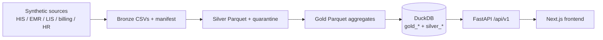

# HOSPITAL 360

**Healthcare Intelligence & Operations Analytics Platform**

A full-stack, multi-hospital analytics platform built on entirely synthetic healthcare
data. HOSPITAL 360 consolidates fragmented operational, clinical-process, financial,
workforce, inventory and patient-experience records into a unified analytical environment
with 21 connected web pages, a documented KPI contract and a reproducible ETL pipeline.

> **Synthetic-data disclaimer.** All hospitals, patients, clinicians, transactions,
> financial values and operational records are fictional. This is an educational analytics
> and portfolio project. It is **not** a clinical system, uses **no real patient records**,
> and is **not** intended for medical diagnosis, treatment decisions or operational use in
> real hospitals. Sentiment labels are synthetic, not AI analysis of real feedback.

---

## 1. Project overview

The fictional network is **NovaCare Health Network**, operating ten hospitals as specified
in the blueprint. Hospital leadership routinely asks questions that span several source
systems: which
hospitals are performing best, why waiting times are rising, where bed capacity is tight,
where revenue is leaking, which claims are denied, which departments are understaffed and
which medicines are running out. HOSPITAL 360 brings those questions into one place.

### Business problem

Operational data in a hospital network is fragmented across HIS, EMR, scheduling,
laboratory, pharmacy, billing, claims, HR, inventory and feedback systems. No single view
lets management compare hospitals, investigate a KPI and drill into the underlying records
without manually reconciling exports.

### Solution

A layered platform: a deterministic synthetic generator produces bronze CSVs; an ETL
pipeline cleans, quarantines and aggregates them into gold models in DuckDB; a FastAPI
service exposes validated KPIs and drill-downs; and a Next.js application presents
21 filter-connected pages. The API is the single source of truth for every business metric.

## 2. Features

- Deterministic synthetic data generator with 10 distinct hospital profiles and controlled
  data-quality issues recorded in a run manifest.
- Bronze -> silver -> gold ETL with Parquet storage, quarantine and DuckDB analytical tables.
- 12 gold models plus network-daily and hospital-monthly workhorses, all with defined grains.
- FastAPI REST API under `/api/v1` with allowlisted filters, pagination, exports, DQ and
  pipeline introspection, and consistent response envelopes.
- 21-page Next.js application: overview, comparisons, 15 module pages, explorer, patient
  journey, data quality, pipeline, KPI glossary and methodology.
- Global URL-based filters, KPI cards with comparison/sparkline/definition, ECharts charts,
  sortable tables, drill-down drawers and CSV export.
- Automated pytest suites (generator, silver, gold, KPI edge cases, API) and Playwright
  end-to-end journey.
- Docker Compose, GitHub Actions CI, deployment documentation and a full data dictionary.

## 3. Screenshots

Screenshots are captured from the running local stack (see section 11), not from mock data.
Capture the Network Overview, Hospital Comparison, Appointments, Finance, Inpatient, Claims,
Data Explorer and Data Quality pages after starting the API and web servers.

## 4. Architecture



The six layers and their responsibilities are described in
[docs/architecture.md](docs/architecture.md). The full table model is in
[docs/erd.md](docs/erd.md), column definitions in
[docs/data_dictionary.md](docs/data_dictionary.md), and the analytical flow in
[docs/methodology.md](docs/methodology.md).

## 5. Technology stack

| Concern | Technology |
|---|---|
| Language | Python 3.13 |
| Data generation | Faker, NumPy, pandas |
| ETL / storage | pandas, Parquet, DuckDB |
| Analytics | SQL (dimensional models, defined fact grains) |
| API | FastAPI, Pydantic, Uvicorn |
| Frontend | Next.js, React, TypeScript, Tailwind CSS |
| Visualisation | Apache ECharts, TanStack Table |
| Testing | pytest, pytest-cov, Playwright |
| CI / deployment | GitHub Actions, Docker, Docker Compose, Vercel / Python host |
| Documentation | Markdown + Mermaid |

## 6. Dataset summary

| Asset | Target (development, not a measured fact) |
|---|---|
| Hospitals | 10 |
| Patients | 15,000+ |
| Departments | 100+ |
| Doctors / staff | 500+ / 2,500+ |
| Appointments / encounters / admissions | 100,000+ / 80,000+ / 20,000+ |
| Bed snapshots / lab orders / lab results | 100,000+ / 100,000+ / 150,000+ |
| Prescriptions / dispensing / invoice lines | 50,000+ / 50,000+ / 100,000+ |
| Claims / shifts / inventory movements | 50,000+ each |
| Patient feedback | 15,000+ |
| **Total records** | **500,000+ target** |
| Reporting window | 24 months: 2025-01-01 to 2026-12-31 |
| Seed | 42 (override with `H360_SEED`) |

Hospital profiles differ deliberately: H01 has the largest overall volume, H03 a larger
cardiology share, H04 pediatric patients, H05 more orthopedic procedures, H08 higher
oncology volume and H09 more emergency encounters. **Actual achieved counts are always
read from `data/manifests/manifest_<run_id>.json`.**

## 7. Data model overview

`generator/schema.py` is the canonical schema for all 39 tables (16 dimensions + 23
transactional / fact-like tables). Dimensions cover hospital, department, specialty,
doctor, staff, payer, diagnosis, procedure, medication, lab test, service, supplier,
inventory item, bed, date and time. Transactional tables span patients and appointments
through encounters, admissions, procedures, labs, pharmacy, finance, claims, workforce,
inventory, feedback and incidents. Fact grains are explicit - for example one row per
appointment, per admission, per bed per snapshot, per invoice, per payment and per claim
header/line/event - so finance and claims are never double counted.

See [docs/erd.md](docs/erd.md) for the Mermaid ER diagram and grains, and
[docs/data_dictionary.md](docs/data_dictionary.md) for every column, dtype, key and grain.

## 8. KPI definitions

Every KPI has a documented ID, business definition, formula, numerator, denominator,
grain, date field, exclusions, source, dimensions, target, caveat and validation. All rates
are percentages `0..100`; a NULL denominator stays NULL rather than becoming a false zero.

- Human-readable dictionary: [docs/kpi_glossary.md](docs/kpi_glossary.md)
- Machine-readable registry: `analytics/kpi_definitions/kpis.json`
- API: `GET /api/v1/kpis/glossary`

## 9. Data quality approach

Bronze keeps original values; silver corrects dtypes, removes duplicates, normalises status
and hospital codes, validates dates and references, and routes invalid rows to
`data/quarantine/` with rule ID, reason, timestamp and run ID - nothing is silently
dropped. Controlled issues (duplicates, missing payers, invalid dates, unknown departments,
invalid statuses, incorrect hospital IDs, negative amounts, orphaned references) are
injected in configured counts and reconciled against the manifest. DQ scoring is a weighted
roll-up of completeness, validity, uniqueness, referential integrity, consistency and
timeliness; the measured score is reported only after a real run. Details:
[docs/methodology.md](docs/methodology.md).

## 10. Installation

```bash
cd hospital360
python -m venv .venv
# Windows: .venv\Scripts\activate    |    macOS/Linux: source .venv/bin/activate
python -m pip install --upgrade pip
python -m pip install -r requirements.txt
# For development / tests:
python -m pip install -r requirements-dev.txt
```

Node 24+ is required for the frontend:

```bash
cd web && npm install && cd ..
```

## 11. Running locally

Run each step from the `hospital360/` directory:

```bash
# 1. Generate synthetic bronze CSVs + manifest
python -m generator.generate

# 2. Build silver + gold Parquet, DuckDB database and quarantine records
python -m etl.pipeline

# 3. Start the API (http://localhost:8000, docs at /docs)
uvicorn api.main:app --reload --port 8000
```

In a second terminal:

```bash
# 4. Start the frontend (http://localhost:3000)
cd web
npm install
npm run dev
```

Open <http://localhost:3000/overview>. If the API reports that the analytical database is
not available, re-run steps 1 and 2 - the API intentionally refuses to serve fabricated
numbers.

## 12. API documentation

- Full endpoint catalogue with example requests/responses:
  [docs/api.md](docs/api.md)
- Interactive OpenAPI docs: <http://localhost:8000/docs> while the API is running.
- Health check: `GET /api/v1/health` -> `{"status":"ok","version":"1.0.0"}`.

## 13. Demo

A three-minute story (blueprint section 35):

1. **Executive overview.** Open `/overview`; point out patient volume, revenue, occupancy,
   satisfaction and the hospital ranking. Filters are visible in the URL.
2. **Investigate a problem.** Select `H03`, change the date range, then click the
   **No-show rate** KPI to open filtered appointment records. Show the department
   breakdown and export the filtered data.
3. **Show the engineering.** Visit `/data-quality` and `/pipeline`, then open `/kpi-glossary`
   and `/methodology` to show definitions, the manifest and the synthetic-data disclaimer.

The automated equivalent of step 2 lives in `web/e2e/analytics.spec.ts`. To run it:

```bash
python -m pip install -r requirements-dev.txt
python -m playwright install chromium
cd web && npm ci
# With the API and frontend running:
npx playwright test --config=e2e/playwright.config.ts
```

## 14. Testing

```bash
cd hospital360
python -m pytest -q              # unit + data + API tests; data-dependent tests SKIP if data absent
python -m ruff check .           # lint
```

Data-dependent suites skip gracefully until `python -m generator.generate` and
`python -m etl.pipeline` have produced the DuckDB file.

## 15. Limitations

- Data is synthetic; distributions are designed, not observed in a real provider.
- Sentiment labels and NPS are generated values, not real survey analytics.
- Gold tables are pre-aggregated; questions outside the defined grains need direct SQL.
- Performance targets (load < 3s, KPI < 2s) are targets to measure, not measured results.
- Ephemeral hosting filesystems do not preserve the DuckDB data across restarts; use
  persistent storage or regenerate during deployment
  ([docs/deployment.md](docs/deployment.md)).
- The quality module is an operational monitoring demo, not clinical decision support.

## 16. Project status

Measured from a local end-to-end run of `python -m generator.generate`,
`python -m etl.pipeline`, `python -m pytest -q`, `npm run build` and
`python scripts/verify_project.py`:

- Generated records (actual): **1,540,892** across 39 bronze tables
- Hospitals / patients: **10** / **15,240**
- Coverage window achieved: **2025-01-01 → 2026-12-31 (24 months)**
- Gold tables loaded in DuckDB: **12** (72 tables total; `gold_hospital_monthly` = 240 rows)
- Automated data-quality score: **96.32 / 100** (297 rules, 1,212 failures, 1,172 quarantined records)
- API: **206 / 206 GET endpoints registered**; all **118 chart-data endpoints** returned HTTP 200 with non-empty data; verifier PASS for bronze, manifest, DuckDB and API
- pytest result (passed / skipped / failed): **82 / 0 / 0**
- Frontend: `npm run build` succeeded (21 routes + hospital profile); `tsc --noEmit` and `npm run lint` clean
- Playwright e2e result: **8 passed / 0 failed** (run from `web/` with `npx playwright test --config=e2e/playwright.config.ts`)
- Blueprint chart coverage: every layout page now renders its full §14 chart list, including 9 data-quality charts and 8 hospital-profile charts
- Live deployment URL: **not deployed** (local stack via `docker-compose.yml`)

See [docs/project_roadmap.md](docs/project_roadmap.md) for the 16-phase status overview and
the blueprint's acceptance checklist, and [docs/portfolio.md](docs/portfolio.md) for risks,
presentation and demonstration notes.

---

HOSPITAL 360 is an educational portfolio project. It uses synthetic data only and makes no
clinical recommendations.

## 17. Disclaimer

HOSPITAL 360 is an educational analytics and portfolio project using entirely synthetic data.
It is not a clinical system, uses no real patient records, and is not intended for diagnosis,
treatment decisions or operational use in real hospitals. All sentiment labels are synthetic.
See [docs/methodology.md](docs/methodology.md) for the full methodology and limitations.
