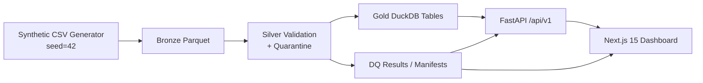

# HOSPITAL 360

**A full-stack healthcare intelligence platform built on synthetic data** - from raw generation to executive dashboards.

[Live Dashboard](https://hospital360-web.vercel.app) · [API Health](https://hospital360-api.onrender.com/api/v1/health) · [API Docs](https://hospital360-api.onrender.com/docs) · [Case Study](docs/CASE_STUDY.md) · [Demo Script](docs/DEMO_SCRIPT.md)

> Synthetic data only. No real patient records, no PHI, no clinical use.

---

## What is HOSPITAL 360?

HOSPITAL 360 is an end-to-end analytics product that simulates how a multi-hospital network can turn fragmented operational data into trusted, decision-ready insights. It covers the full pipeline: **data generation → validation/quarantine → analytical marts → API → interactive dashboard**.

It’s built as a portfolio-grade system, not just a chart demo: reproducible data, KPI contracts, data quality checks, drill-downs, exports, and automated tests.

## Highlights

| | |
|---|---|
| **21 dashboard pages** | Executive, clinical, financial, workforce, supply chain, experience, quality, explorer, DQ, pipeline |
| **1.58M+ synthetic records** | 10 hospitals, 2 years, reproducible seed-42 generation |
| **58 analytical tables** | Bronze/Silver/Gold DuckDB model with quarantine and manifests |
| **43 API route handlers** | Versioned FastAPI endpoints under `/api/v1` |
| **159 + 44 automated tests** | pytest backend suite + Playwright E2E/a11y checks |
| **DQ score: 100.0** | Validation rules, quarantine tracking, lineage, run manifests |

## Live Links

- **Frontend:** https://hospital360-web.vercel.app
- **Backend API:** https://hospital360-api.onrender.com/api/v1
- **Health:** https://hospital360-api.onrender.com/api/v1/health
- **Swagger Docs:** https://hospital360-api.onrender.com/docs

> Note: Backend runs on Render Free tier and may cold-start after inactivity.

## Product Modules

| Domain | What you can explore |
|---|---|
| **Executive** | Network overview, hospital comparison, hospital profile |
| **Operations** | Appointments/access, emergency flow, inpatient/beds, procedures, diagnostics |
| **Business** | Pharmacy, finance/revenue, claims, workforce, inventory/procurement |
| **Performance** | Patient experience, quality & safety |
| **Data & Intelligence** | Data explorer, patient journey, data quality, pipeline, KPI glossary, methodology |

## Architecture



**Design principle:** business KPIs are defined/calculated in the backend/data layer; the frontend renders API data and does not compute business KPIs.

## Tech Stack

| Layer | Stack |
|---|---|
| **Frontend** | Next.js 15.5, React 19, TypeScript, Tailwind CSS, ECharts 6, TanStack Query/Table |
| **Backend** | FastAPI, Pydantic, Uvicorn |
| **Data** | Python, Pandas/NumPy, DuckDB, Parquet |
| **Testing** | pytest, Playwright, axe-core |
| **CI/CD** | GitHub Actions |
| **Deployment** | Vercel (frontend), Render Docker Web Service (backend) |

## Measured Data Snapshot

From `data/manifests/pipeline_RUN_20261121_001.json`:

| Metric | Value |
|---:|---:|
| Source records | 1,588,637 |
| Valid records | 1,585,844 |
| Quarantined records | 2,793 |
| Quarantine rule failures | 2,833 |
| Tables created | 58 |
| DQ score | 100.0 |

## Data Quality & Trust

- Rule-based validation with quarantine (not silent drops).
- DQ summaries, rule failures, dataset health, lineage, and run manifests exposed in UI/API.
- Parameterized SQL practices, allowlisted dynamic identifiers, env-based CORS, export row cap (`MAX_EXPORT_ROWS=5000`).
- See: [Data Quality Report](docs/data_quality_report.md) · [Accessibility](docs/accessibility.md) · [KPI Dictionary](docs/kpi_dictionary.md)

## Quick Start (Local)

### 1) Clone & install

```bash
git clone https://github.com/farhankh8/hospital-360-healthcare-analytics.git
cd hospital-360-healthcare-analytics
python -m venv .venv
# Windows: .venv\Scripts\activate
# macOS/Linux: source .venv/bin/activate
pip install -r requirements.txt
cd web && npm ci && cd ..
```

### 2) Run backend

```bash
python -m uvicorn api.main:app --host 127.0.0.1 --port 8000
```

### 3) Run frontend

```bash
cd web
npm run dev
```

- Web: http://127.0.0.1:3000
- API: http://127.0.0.1:8000/api/v1/health
- Docs: http://127.0.0.1:8000/docs

## Checks

```bash
python -m pytest -q
python -m ruff check .
cd web && npm run lint && npx tsc --noEmit && npm run build
npx playwright test --config=e2e/playwright.config.ts
```

## Deployment

Prepared for split deployment:

- **Frontend:** Vercel (`web/`, env: `NEXT_PUBLIC_API_URL`)
- **Backend:** Render Docker (`Dockerfile.api`, env: `CORS_ORIGINS`, `DATA_PATH`, `DATABASE_PATH`, `APP_ENV`, `LOG_LEVEL`)

Details: [docs/deployment.md](docs/deployment.md)

## Repository Docs

- [Architecture](docs/architecture.md)
- [Data Model](docs/data_model.md)
- [ERD](docs/ERD.dbml)
- [KPI Dictionary](docs/kpi_dictionary.md)
- [API Reference](docs/api_reference.md)
- [Data Quality Report](docs/data_quality_report.md)
- [Deployment](docs/deployment.md)
- [Case Study](docs/CASE_STUDY.md)
- [Demo Script](docs/DEMO_SCRIPT.md)

## Limitations

- Synthetic data only; not for clinical, operational, or financial decisions.
- Render Free tier may cold-start after inactivity.
- Local performance measurements are machine-specific, not production SLOs.

## Disclaimer

HOSPITAL 360 uses entirely synthetic data. No real patient data, real hospital identities, or PHI are included. Outputs are for demonstration and portfolio purposes only.
