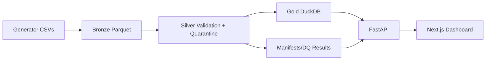

# HOSPITAL 360 - Case Study

## Problem
Healthcare management teams often operate across fragmented systems for appointments, inpatient flow, billing, claims, workforce, inventory, and experience. This makes it difficult to monitor performance consistently, investigate root causes, and trust KPI comparability across hospitals.

## Data challenge
The project required realistic, relational, multi-hospital synthetic data at scale while preserving referential integrity and introducing controlled quality issues. The measured pipeline run (`RUN_20261121_001`) processed **1,588,637 source records**, produced **1,585,844 valid records**, quarantined **2,793 records**, and recorded **2,833 quarantine rule failures**, with an overall DQ score of **100.0** per `data/manifests/dq_results.json`.

## Architecture

Key components: Python generator/ETL, DuckDB warehouse, FastAPI `/api/v1`, Next.js 15 frontend, Playwright/pytest/CI quality gates.

## Data quality examples
- **Quarantine visibility**: quarantined rows and rule failures are surfaced in pipeline/DQ artifacts and API-driven pages.
- **Rule traceability**: DQ results and manifests record run-level outcomes (`RUN_20261121_001`, DQ 100.0).
- **Validation guardrails**: API filter validation, parameterized SQL, allowlisted dynamic identifiers, export row limits, and env-configured CORS.

## KPI examples
- **Operational**: occupancy, ALOS, ED wait, appointment no-show/completion.
- **Financial**: gross/net revenue, collection rate, AR/denial-related metrics from finance/claims endpoints.
- **Experience/Quality**: satisfaction/NPS and quality incident indicators.
All KPI values shown in UI are API-provided; frontend does not compute business KPIs.

## Dashboard capabilities
- 21 routes with global filters and URL sync.
- Drilldowns, searchable/sortable tables, CSV exports.
- Data Explorer and Patient Journey for record-level investigation.
- Data Quality and Pipeline pages for trust/lineage/run comparison.
- Accessibility hardening: axe serious/critical checks pass on overview/finance/explorer/data-quality (Chromium + mobile).

## Deployment
Deployment is prepared, not executed in this environment. Artifacts: `Dockerfile.api`, `docker-compose.yml`, `render.yaml`, `web/vercel.json`, `scripts/smoke_deployed.py`, `.github/workflows/smoke-deployed.yml`, and [docs/deployment.md](deployment.md). Target: Render Docker Web Service for API, Vercel for web.

## Lessons learned
- A strict API envelope and shared filter/query layer prevent KPI drift and UI inconsistency.
- Data quality must be visible as product behavior (quarantine/manifests/pages), not just ETL logs.
- Small accessibility fixes (labels, contrast, focus) can be validated reliably with axe + Playwright.
- Deployment prep should be scripted and smoke-tested before any live credentials are used.
