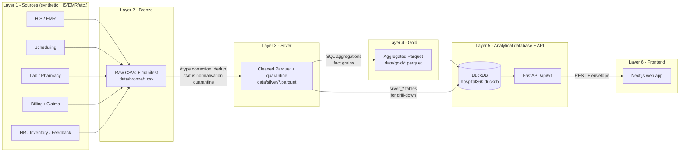
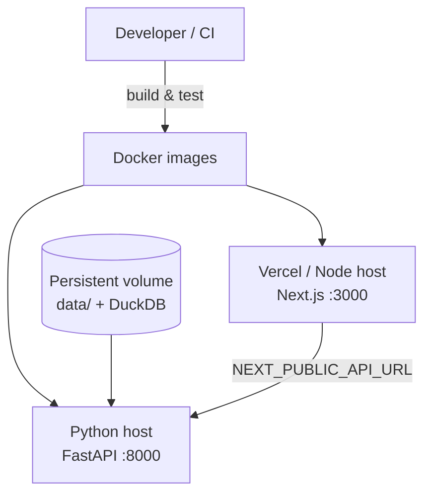

# HOSPITAL 360 - Architecture

## Overview

HOSPITAL 360 is a layered, API-first healthcare analytics platform built entirely on
synthetic data. Data flows in one direction through six layers; the frontend never
computes its own business KPI definitions. The API is the single source of truth for
analytical metrics, and `generator/schema.py` is the single source of truth for
transactional column contracts (see [CONTRACT.md](../CONTRACT.md)).

## Layered architecture

## Layer responsibilities

| Layer | Owns | Must NOT do |
|---|---|---|
| 1. Sources | Deterministic synthetic generation (`seed=42`), hospital-specific profiles, controlled DQ issues, manifest | Emit real patient data; fabricate measured results |
| 2. Bronze | Immutable raw CSVs, original values, batch/run metadata | Silently transform or drop invalid rows |
| 3. Silver | Dtype correction, dedup, null handling, ID/date validation, status + hospital-code normalisation, referential checks, quarantine | Change business definitions; discard records without a quarantine record |
| 4. Gold | Business-ready aggregates at defined grains; rates as 0-100; NULL denominators stay NULL | Invent zeroes for undefined rates; mix invoice/payment/claim grains |
| 5. DuckDB + API | Parameterised SQL, allowlisted filters, pagination, exports, envelope responses, data-quality and pipeline introspection | Accept arbitrary SQL; return inconsistent envelopes |
| 6. Frontend | KPI cards, charts, tables, drill-downs, global URL-based filters, exports | Hard-code metric values; calculate conflicting KPI definitions |

## Technology choices

| Concern | Choice | Rationale |
|---|---|---|
| Language | Python 3.13 | Generator, ETL and API share one ecosystem |
| Generation | Faker + NumPy + pandas | Reproducible, realistic variation with controlled missingness |
| Storage | Bronze CSV, silver/gold Parquet | Raw traceability plus columnar efficiency |
| Analytics DB | DuckDB | Local analytical SQL, fast aggregates, no server to manage |
| API | FastAPI + Pydantic | Typed validation, OpenAPI docs, async-ready |
| Frontend | Next.js + React + TypeScript | Server rendering, route structure, component reuse |
| Styling / charts | Tailwind CSS + Apache ECharts | Restrained healthcare palette, advanced charts |
| Tables | TanStack Table | Sorting, filtering, pagination, column visibility |
| Testing | pytest + Playwright | Data/API unit tests plus real browser journeys |
| CI / containers | GitHub Actions + Docker | Reproducible lint, tests, build and deployment |

## Detailed data flow

1. **Generate.** `python -m generator.generate` writes one CSV per canonical table into
   `data/bronze/` and a run manifest into `data/manifests/manifest_<run_id>.json`. The
   manifest records actual achieved counts and the intentionally injected DQ issues.
2. **Ingest to silver.** `python -m etl.pipeline` reads bronze, coerces declared dtypes,
   de-duplicates by primary key, normalises status labels and hospital codes, validates
   dates and references, and routes invalid rows to `data/quarantine/` with rule ID,
   failure reason, timestamp and run ID. Clean rows are written as Parquet.
3. **Build gold.** SQL transformations aggregate silver into 12 gold models plus a
   network-daily model. Every rate has an explicit numerator and denominator; a zero
   denominator yields `NULL`, not `0`.
4. **Load DuckDB.** Gold tables are materialised as tables (not only views) in
   `data/hospital360.duckdb`; silver transactional tables are loaded with a `silver_`
   prefix to power the Data Explorer and record-level drill-downs.
5. **Serve.** FastAPI opens a fresh read-only DuckDB connection per request, builds
   `WHERE` clauses from allowlisted columns and bound parameters, and wraps responses in
   the standard envelope (`data`, `metadata`, optional `pagination`).
6. **Present.** Next.js pages read only from the API. Global filters live in URL query
   parameters and React context, so a filtered view is shareable, survives refresh and
   propagates to cards, charts, tables and exports.

## Cross-cutting concerns

- **Security / privacy:** no real patient data, no credentials in Git, configuration via
  environment variables, CORS allowlist, parameterised SQL, export row caps, and logs
  without sensitive values. See [deployment.md](deployment.md) and blueprint section 26.
- **Data quality:** validation categories are completeness, validity, uniqueness,
  referential integrity, consistency and timeliness. The overall DQ score is a weighted
  category score, documented in [methodology.md](methodology.md); intentional DQ issues
  are reconciled against the manifest rather than silently averaged away.
- **Performance:** filter before aggregating, pre-aggregate into gold, paginate detail
  tables, cache common aggregates where useful, and keep exports bounded.
- **Reproducibility:** fixed seed, versioned generator, manifest per run, Docker images,
  pinned dependencies and CI.

## Deployment view

> Ephemeral hosting filesystems do not preserve generated data across restarts. Use
> persistent storage or regenerate/load the dataset during deployment; see
> [deployment.md](deployment.md).
