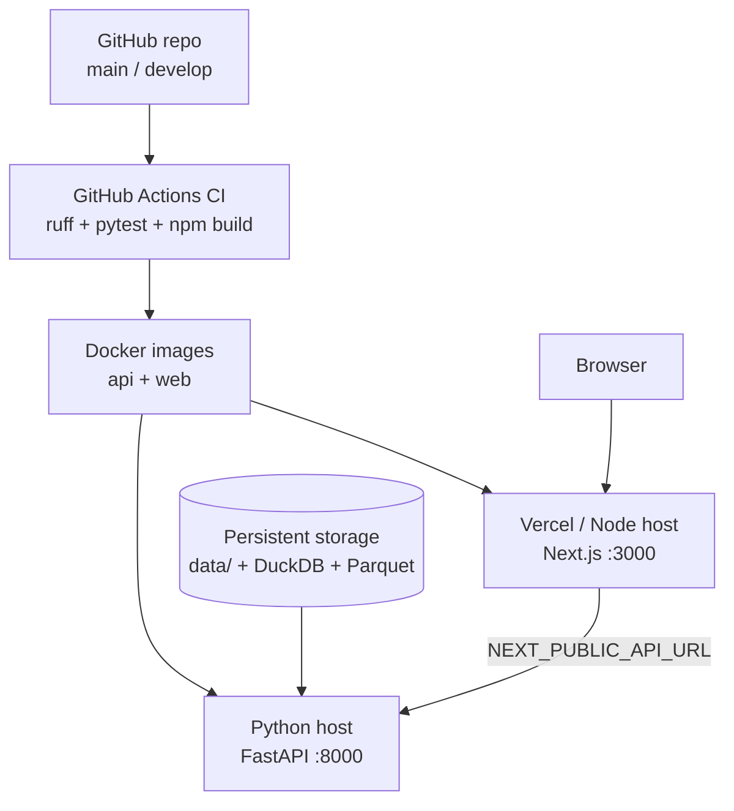

# HOSPITAL 360 - Deployment

> **Status: deployment preparation only.** No live deployment or cloud accounts were created in this phase. The artifacts below are prepared for Docker/self-hosted or Vercel+Python-host deployment.

## Deployment architecture



The frontend and backend are deployed independently. The API reads a DuckDB file that is
produced by the generator + ETL pipeline; the frontend calls the API and never talks to the
database directly.

## Environment variables

| Variable | Used by | Default | Purpose |
|---|---|---|---|
| `DATA_PATH` | API, Docker | `<repo>/data` | Root of bronze/silver/gold/quarantine/manifests |
| `DATABASE_PATH` | API, Docker | `<DATA_PATH>/hospital360.duckdb` | DuckDB analytical database |
| `CORS_ORIGINS` | API | `http://localhost:3000,http://127.0.0.1:3000` | Comma-separated browser origins |
| `APP_ENV` | API | `development` | `development` / `staging` / `production` |
| `LOG_LEVEL` | API | `INFO` | Logging verbosity (no sensitive values logged) |
| `NEXT_PUBLIC_API_URL` | Frontend | `http://localhost:8000/api/v1` | Public API base URL, baked at build time |
| `H360_SEED` | Generator | `42` | Reproducibility seed |

Never place secret credentials in `NEXT_PUBLIC_*` variables: they are embedded in the client
bundle. This project requires no API secrets.

## Option A - Docker (recommended for local and self-hosted)

```bash
cd hospital360
cp .env.example .env   # keeps NEXT_PUBLIC_API_URL=http://localhost:8000/api/v1
# 1. Generate data and build the analytical database once on the host,
#    or run the same commands inside a container that mounts ./data.
python -m pip install -r requirements.txt
python -m generator.generate
python -m etl.pipeline

# 2. Build and start api + web.
docker compose up --build -d

# 3. Check health and open the app.
curl http://localhost:8000/api/v1/health
curl http://localhost:8000/openapi.json | python -c "import json,sys; s=json.load(sys.stdin); print('/api/v1/exports/csv' in s['paths'])"
# http://localhost:3000
```

`docker-compose.yml` mounts `./data` into the API container, so generated data persists on
the host. It also wires `DATA_PATH`, `DATABASE_PATH`, `CORS_ORIGINS` and
`NEXT_PUBLIC_API_URL`, and defines healthchecks for both services. The web service waits
for the API healthcheck before starting.

## Option B - Vercel frontend + Python backend host

1. **Backend.** Deploy the FastAPI app to a Python-compatible host (Render, Fly.io,
   Cloud Run, a VM, etc.):
   ```bash
   uvicorn api.main:app --host 0.0.0.0 --port 8000
   ```
   Configure `DATA_PATH`, `DATABASE_PATH`, `CORS_ORIGINS`, `APP_ENV` and `LOG_LEVEL`.
   Mount or restore `data/` so the DuckDB file is available at `DATABASE_PATH`.
2. **Frontend.** Import the `web/` directory into Vercel (Next.js preset). Set
   `NEXT_PUBLIC_API_URL` to the public versioned API base URL (e.g.
   `https://api.example.com/api/v1`) and rebuild. Ensure the backend CORS allowlist includes the
   Vercel domain.
3. **Verify.** Open the deployed `/overview`, confirm cards render API values, and check
   `/api/v1/health` returns `{"status":"ok","version":"1.0.0"}`.

## Persistent storage warning

> DuckDB and the generated Parquet/CSV files live on the local filesystem. **Ephemeral
> hosting filesystems do not preserve generated data across restarts or redeploys.** For a
> durable deployment you must either:
> - mount a persistent volume containing `data/` (including
>   `data/hospital360.duckdb`), or
> - regenerate the dataset during deployment with `python -m generator.generate &&
>   python -m etl.pipeline` before starting the API, or
> - bundle a prebuilt read-only analytical database into the image/artifact.
>
> A serverless frontend cannot host DuckDB; keep the database with the Python backend.

## Data preparation on a fresh host

```bash
export DATA_PATH=/srv/hospital360/data
export DATABASE_PATH=$DATA_PATH/hospital360.duckdb
python -m pip install -r requirements.txt
python -m generator.generate          # writes bronze CSVs + data/manifests/manifest_*.json
python -m etl.pipeline                # writes silver/gold Parquet + DuckDB + quarantine
```

Confirm the manifest reports actual counts and zero unexplained pipeline failures before
exposing the API.

## Health checks and verification

- API: `GET /api/v1/health` -> `{"status":"ok","version":"1.0.0"}` (no envelope).
- Frontend: `GET /` returns the rendered Next.js app.
- Data: `GET /api/v1/data-quality/summary` and `GET /api/v1/pipeline/manifest` return
  quality and run metadata (requires the DuckDB file).
- CI: `.github/workflows/ci.yml` runs Ruff + pytest for the backend and `npm ci && npm run
  build` for the frontend. It needs no secrets.

## Security checklist (blueprint section 26)

- [x] Environment variables for configuration; no credentials in Git
- [x] CORS origin allowlist
- [x] Parameterised SQL and allowlisted filter columns; no arbitrary SQL
- [x] Pagination, page-size caps and export row limits
- [x] Consistent error responses and API versioning under `/api/v1`
- [x] Synthetic-only data; no real patient information
- [ ] Verify production host TLS, log retention and backup of the persistent volume
