# HOSPITAL 360 - Entity Relationship Diagram

> Generated from `generator/schema.py`. All 39 tables (16 dimensions + 23
> transactional / fact-like tables) are shown with their columns. Fact grains
> follow blueprint section 9 and are repeated below for quick reference.

## ER diagram

```mermaid
erDiagram
    dim_hospital {
        string hospital_id PK "H01..H10"
        string hospital_name
        string city
        string profile
        string hospital_type
        int beds
        string status
        float latitude
        float longitude
    }
    dim_specialty {
        string specialty_id PK "S01.."
        string specialty_name
    }
    dim_department {
        string department_id PK "D001.."
        string hospital_id FK "Parent hospital"
        string department_name
        string specialty_id FK "Primary specialty"
    }
    dim_doctor {
        string doctor_id PK "DOC0001.."
        string hospital_id FK "Parent hospital"
        string department_id FK "Parent department"
        string doctor_name
        string specialty_id FK "Specialty"
        string role
    }
    dim_staff {
        string staff_id PK "STF00001.."
        string hospital_id FK "Parent hospital"
        string department_id FK "Parent department"
        string staff_name
        string role
        string employment_type
        string status
        float hourly_rate
    }
    dim_payer {
        string payer_id PK "P01.."
        string payer_name
        string payer_type
    }
    dim_diagnosis {
        string diagnosis_code PK "ICD-like code"
        string diagnosis_name
        string category
    }
    dim_procedure {
        string procedure_code PK "CPT-like code"
        string procedure_name
        string specialty_id FK "Owning specialty"
        string category
    }
    dim_medication {
        string medication_code PK "MED0001.."
        string medication_name
        string category
        float unit_cost
    }
    dim_lab_test {
        string test_code PK "LAB0001.."
        string test_name
        string category
        int sla_minutes
    }
    dim_service {
        string service_code PK "SVC0001.."
        string service_name
        string category
        float unit_price
    }
    dim_supplier {
        string supplier_id PK "SUP0001.."
        string supplier_name
        int lead_days
        float reliability_score
    }
    dim_inventory_item {
        string item_id PK "ITEM00001.."
        string item_name
        string category
        float unit_cost
        int reorder_level
        string supplier_id FK "Preferred supplier"
    }
    dim_bed {
        string bed_id PK "BED-H01-0001.."
        string hospital_id FK "Parent hospital"
        string ward
        string bed_type
    }
    dim_date {
        int date_key PK "YYYYMMDD"
        date full_date
        int year
        int quarter
        int month
        string month_name
        int day
        int weekday
        string weekday_name
        boolean is_weekend
    }
    dim_time {
        int time_key PK "HHMM"
        int hour
        int minute
        string hour_bucket
    }
    patients {
        string patient_id PK "PAT000001.."
        string first_name
        string last_name
        date birth_date
        string gender
        string city
        string state
        date registration_date
        string blood_type
        string patient_type
    }
    appointments {
        string appointment_id PK "APT0000001.."
        string patient_id FK "FK patients"
        string hospital_id FK "FK dim_hospital"
        string department_id FK "FK dim_department"
        string doctor_id FK "FK dim_doctor"
        date booking_date
        date appointment_date
        string appointment_type
        string status
        datetime checkin_datetime
        float waiting_minutes
        string cancellation_reason
        string booking_channel
        int lead_days
        boolean rescheduled_flag
    }
    encounters {
        string encounter_id PK "ENC0000001.."
        string patient_id FK "FK patients"
        string appointment_id FK "FK appointments (nullable)"
        string hospital_id FK "FK dim_hospital"
        string department_id FK "FK dim_department"
        string encounter_type
        datetime arrival_datetime
        string triage_category
        datetime triage_datetime
        datetime provider_datetime
        datetime disposition_datetime
        float waiting_minutes
        float treatment_minutes
        string disposition
        string arrival_mode
        boolean critical_flag
    }
    admissions {
        string admission_id PK "ADM000001.."
        string encounter_id FK "FK encounters"
        string patient_id FK "FK patients"
        string hospital_id FK "FK dim_hospital"
        string department_id FK "FK dim_department"
        string ward
        string bed_id FK "FK dim_bed"
        datetime admission_datetime
        datetime discharge_datetime
        string admission_type
        string discharge_status
        float los_days
        boolean readmission_flag
        float boarding_hours
    }
    transfers {
        string transfer_id PK "TRF000001.."
        string admission_id FK "FK admissions"
        string patient_id FK "FK patients"
        string hospital_id FK "FK dim_hospital"
        string from_ward
        string to_ward
        datetime transfer_datetime
        string reason
    }
    bed_snapshots {
        string snapshot_id PK "SNP0000001.."
        datetime snapshot_datetime
        string hospital_id FK "FK dim_hospital"
        string ward
        string bed_id FK "FK dim_bed"
        string bed_type
        string status
        boolean occupied_flag
        boolean blocked_flag
    }
    procedures {
        string procedure_id PK "PRC0000001.."
        string patient_id FK "FK patients"
        string encounter_id FK "FK encounters"
        string hospital_id FK "FK dim_hospital"
        string department_id FK "FK dim_department"
        string or_room
        string surgeon_id FK "FK dim_doctor"
        string procedure_code FK "FK dim_procedure"
        datetime scheduled_start
        datetime actual_start
        datetime actual_end
        float duration_minutes
        float delay_minutes
        string status
        string cancellation_reason
        string elective_emergency
        float revenue
    }
    lab_orders {
        string lab_order_id PK "LBO0000001.."
        string patient_id FK "FK patients"
        string encounter_id FK "FK encounters"
        string hospital_id FK "FK dim_hospital"
        string ordering_department FK "Ordering department"
        string test_code FK "FK dim_lab_test"
        string priority
        datetime ordered_at
        datetime collection_at
        string status
    }
    lab_results {
        string result_id PK "LBR0000001.."
        string lab_order_id FK "FK lab_orders"
        string patient_id FK "FK patients"
        string test_code FK "Test performed"
        datetime result_at
        float result_value
        string result_flag
        boolean is_critical
        float tat_minutes
        string status
    }
    prescriptions {
        string prescription_id PK "RX0000001.."
        string patient_id FK "FK patients"
        string encounter_id FK "FK encounters"
        string hospital_id FK "FK dim_hospital"
        string medication_code FK "FK dim_medication"
        int quantity
        date prescribed_date
        string status
        float amount
    }
    dispensing {
        string dispensing_id PK "DSP0000001.."
        string prescription_id FK "FK prescriptions"
        string hospital_id FK "FK dim_hospital"
        string pharmacy_id
        date dispensed_date
        int quantity_dispensed
        string status
    }
    invoices {
        string invoice_id PK "INV0000001.."
        string encounter_id FK "FK encounters"
        string patient_id FK "FK patients"
        string hospital_id FK "FK dim_hospital"
        string payer_id FK "FK dim_payer"
        date invoice_date
        float gross_amount
        float discount_amount
        float net_amount
        float paid_amount
        float balance_amount
        string invoice_status
        string payment_status
    }
    invoice_lines {
        string line_id PK "IL00000001.."
        string invoice_id FK "FK invoices"
        string service_code FK "FK dim_service"
        string service_category
        string description
        int quantity
        float unit_price
        float line_amount
    }
    payments {
        string payment_id PK "PAY0000001.."
        string invoice_id FK "FK invoices"
        string patient_id FK "FK patients"
        date payment_date
        float amount
        string method
        string payment_type
        string status
    }
    claims {
        string claim_id PK "CLM0000001.."
        string invoice_id FK "FK invoices"
        string patient_id FK "FK patients"
        string hospital_id FK "FK dim_hospital"
        string payer_id FK "FK dim_payer"
        date claim_date
        float claim_amount
        float approved_amount
        float paid_amount
        string status
        string denial_reason
        float processing_days
        string claim_type
    }
    claim_lines {
        string claim_line_id PK "CXL0000001.."
        string claim_id FK "FK claims"
        string service_code FK "Service code"
        float line_amount
        string status
    }
    claim_events {
        string event_id PK "CVE0000001.."
        string claim_id FK "FK claims"
        date event_date
        string event_type
        string status
    }
    shifts {
        string shift_id PK "SFT0000001.."
        string staff_id FK "FK dim_staff"
        string hospital_id FK "FK dim_hospital"
        string department_id FK "FK dim_department"
        date shift_date
        string shift_type
        float scheduled_hours
        float actual_hours
        float overtime_hours
    }
    attendance {
        string attendance_id PK "ATT0000001.."
        string shift_id FK "FK shifts"
        string staff_id FK "FK dim_staff"
        date attendance_date
        string status
        float hours_worked
    }
    inventory_movements {
        string movement_id PK "INVM0000001.."
        string hospital_id FK "FK dim_hospital"
        string item_id FK "FK dim_inventory_item"
        string supplier_id FK "FK dim_supplier"
        date movement_date
        string movement_type
        int quantity
        float unit_cost
        date expiry_date
    }
    purchase_orders {
        string po_id PK "PO0000001.."
        string hospital_id FK "FK dim_hospital"
        string supplier_id FK "FK dim_supplier"
        date order_date
        date expected_date
        date received_date
        string status
        float total_amount
    }
    feedback {
        string feedback_id PK "FBK0000001.."
        string patient_id FK "FK patients"
        string hospital_id FK "FK dim_hospital"
        string department_id FK "FK dim_department"
        date visit_date
        int rating
        string category
        string sentiment_label
        boolean complaint_flag
        string complaint_text
        string resolution_status
        float resolution_days
        string feedback_type
        int nps_score
    }
    incidents {
        string incident_id PK "INC0000001.."
        string hospital_id FK "FK dim_hospital"
        string department_id FK "FK dim_department"
        date incident_date
        string category
        string severity
        string status
        boolean investigation_complete_flag
        float investigation_days
        date resolution_date
    }

    admissions ||--o{ transfers : "admission_id"
    appointments ||--o{ encounters : "appointment_id"
    claims ||--o{ claim_events : "claim_id"
    claims ||--o{ claim_lines : "claim_id"
    dim_bed ||--o{ admissions : "bed_id"
    dim_bed ||--o{ bed_snapshots : "bed_id"
    dim_department ||--o{ admissions : "department_id"
    dim_department ||--o{ appointments : "department_id"
    dim_department ||--o{ dim_doctor : "department_id"
    dim_department ||--o{ dim_staff : "department_id"
    dim_department ||--o{ encounters : "department_id"
    dim_department ||--o{ feedback : "department_id"
    dim_department ||--o{ incidents : "department_id"
    dim_department ||--o{ lab_orders : "ordering_department"
    dim_department ||--o{ procedures : "department_id"
    dim_department ||--o{ shifts : "department_id"
    dim_doctor ||--o{ appointments : "doctor_id"
    dim_doctor ||--o{ procedures : "surgeon_id"
    dim_hospital ||--o{ admissions : "hospital_id"
    dim_hospital ||--o{ appointments : "hospital_id"
    dim_hospital ||--o{ bed_snapshots : "hospital_id"
    dim_hospital ||--o{ claims : "hospital_id"
    dim_hospital ||--o{ dim_bed : "hospital_id"
    dim_hospital ||--o{ dim_department : "hospital_id"
    dim_hospital ||--o{ dim_doctor : "hospital_id"
    dim_hospital ||--o{ dim_staff : "hospital_id"
    dim_hospital ||--o{ dispensing : "hospital_id"
    dim_hospital ||--o{ encounters : "hospital_id"
    dim_hospital ||--o{ feedback : "hospital_id"
    dim_hospital ||--o{ incidents : "hospital_id"
    dim_hospital ||--o{ inventory_movements : "hospital_id"
    dim_hospital ||--o{ invoices : "hospital_id"
    dim_hospital ||--o{ lab_orders : "hospital_id"
    dim_hospital ||--o{ prescriptions : "hospital_id"
    dim_hospital ||--o{ procedures : "hospital_id"
    dim_hospital ||--o{ purchase_orders : "hospital_id"
    dim_hospital ||--o{ shifts : "hospital_id"
    dim_hospital ||--o{ transfers : "hospital_id"
    dim_inventory_item ||--o{ inventory_movements : "item_id"
    dim_lab_test ||--o{ lab_orders : "test_code"
    dim_lab_test ||--o{ lab_results : "test_code"
    dim_medication ||--o{ prescriptions : "medication_code"
    dim_payer ||--o{ claims : "payer_id"
    dim_payer ||--o{ invoices : "payer_id"
    dim_procedure ||--o{ procedures : "procedure_code"
    dim_service ||--o{ claim_lines : "service_code"
    dim_service ||--o{ invoice_lines : "service_code"
    dim_specialty ||--o{ dim_department : "specialty_id"
    dim_specialty ||--o{ dim_doctor : "specialty_id"
    dim_specialty ||--o{ dim_procedure : "specialty_id"
    dim_staff ||--o{ attendance : "staff_id"
    dim_staff ||--o{ shifts : "staff_id"
    dim_supplier ||--o{ dim_inventory_item : "supplier_id"
    dim_supplier ||--o{ inventory_movements : "supplier_id"
    dim_supplier ||--o{ purchase_orders : "supplier_id"
    encounters ||--o{ admissions : "encounter_id"
    encounters ||--o{ invoices : "encounter_id"
    encounters ||--o{ lab_orders : "encounter_id"
    encounters ||--o{ prescriptions : "encounter_id"
    encounters ||--o{ procedures : "encounter_id"
    invoices ||--o{ claims : "invoice_id"
    invoices ||--o{ invoice_lines : "invoice_id"
    invoices ||--o{ payments : "invoice_id"
    lab_orders ||--o{ lab_results : "lab_order_id"
    patients ||--o{ admissions : "patient_id"
    patients ||--o{ appointments : "patient_id"
    patients ||--o{ claims : "patient_id"
    patients ||--o{ encounters : "patient_id"
    patients ||--o{ feedback : "patient_id"
    patients ||--o{ invoices : "patient_id"
    patients ||--o{ lab_orders : "patient_id"
    patients ||--o{ lab_results : "patient_id"
    patients ||--o{ payments : "patient_id"
    patients ||--o{ prescriptions : "patient_id"
    patients ||--o{ procedures : "patient_id"
    patients ||--o{ transfers : "patient_id"
    prescriptions ||--o{ dispensing : "prescription_id"
    shifts ||--o{ attendance : "shift_id"
```

## Grain reference

### Transactional tables (blueprint section 9)

| Table | Grain |
|---|---|
| `patients` | One row per patient |
| `appointments` | One row per appointment |
| `encounters` | One row per encounter |
| `admissions` | One row per admission |
| `transfers` | One row per transfer |
| `bed_snapshots` | One row per bed per snapshot date/time |
| `procedures` | One row per procedure event |
| `lab_orders` | One row per lab order |
| `lab_results` | One row per test result |
| `prescriptions` | One row per prescription |
| `dispensing` | One row per dispensing transaction |
| `invoices` | One row per invoice |
| `invoice_lines` | One row per invoice line |
| `payments` | One row per payment transaction |
| `claims` | One row per insurance claim (claim header) |
| `claim_lines` | One row per claim line |
| `claim_events` | One row per claim status event |
| `shifts` | One row per staff shift |
| `attendance` | One row per attendance event |
| `inventory_movements` | One row per stock movement |
| `purchase_orders` | One row per purchase order |
| `feedback` | One row per patient feedback submission |
| `incidents` | One row per quality / safety incident |

### Fact tables (analytic grain)

| Fact | Grain | Notes / measures |
|---|---|---|
| Fact appointment | One row per appointment | scheduled, completed, cancelled, no-shows, waiting time |
| Fact encounter | One row per encounter | volume, service duration, encounter type, disposition |
| Fact admission | One row per admission | LOS, admission type, discharge type, readmission |
| Fact bed snapshot | One row per bed per snapshot date/time | occupied / available / blocked beds, occupancy |
| Fact procedure | One row per procedure event | volume, duration, delay, cancellation, OR utilization |
| Fact laboratory | One row per lab order or per result | TAT, completion, delays, volume |
| Fact finance - invoice | One row per invoice | gross, discount, net, paid, balance |
| Fact finance - invoice line | One row per line | quantity, unit price, line amount |
| Fact finance - payment | One row per payment | amount, method, type, status |
| Fact claims - header | One row per claim | claimed / approved / paid amount, status |
| Fact claims - line | One row per claim line | service code, line amount, status |
| Fact claims - event | One row per status event | event type, resulting status |
| Fact workforce - shift | One row per shift | scheduled / actual / overtime hours |
| Fact workforce - attendance | One row per attendance event | Present / Absent / Late / Leave |
| Fact inventory | One row per stock movement | Receipt / Issue / Transfer / Adjustment / Return / Waste / Expiry |

## Cardinality notes

- `dim_hospital ||--o{` most transactional tables: one hospital has many records;
  each record belongs to exactly one hospital (after silver code normalisation).
- `patients ||--o{ appointments|encounters|invoices|claims|feedback`: a synthetic
  patient may have many events across the 24-month window.
- `appointments |o--o| encounters`: an encounter may reference an appointment;
  walk-in / emergency encounters legitimately have no appointment.
- `encounters ||--o{ admissions`: an emergency encounter may lead to at most one
  admission in this model; not every encounter produces an admission.
- `admissions ||--o{ transfers`: multiple ward transfers per admission are allowed.
- `dim_bed ||--o{ bed_snapshots`: one physical bed has many time-stamped snapshots;
  the snapshot grain prevents double counting of bed-days.
- `invoices ||--o{ invoice_lines`, `invoices ||--o{ payments`,
  `invoices ||--o{ claims`: finance grains are kept separate to avoid double counting.
- `claims ||--o{ claim_lines` and `claims ||--o{ claim_events`: header, line and
  event facts are distinct grains; denial and processing analysis use the header.
- `shifts ||--o{ attendance`: attendance is recorded per shift / staff member.
- `dim_inventory_item ||--o{ inventory_movements`: stock movements are signed and
  netted to compute on-hand value; `dim_supplier ||--o{ purchase_orders` tracks lead time.

## Mapping to gold models

Gold models aggregate these grains into hospital x month (the workhorse table),
hospital x department x month, and module-specific grains. See `CONTRACT.md`
section 3 for the exact column lists and [architecture.md](architecture.md) for
the bronze -> silver -> gold flow.
