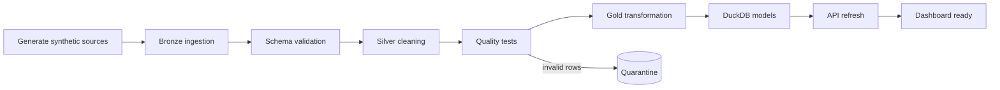

# HOSPITAL 360 - Methodology & Disclaimer

## Disclaimer (read first)

> HOSPITAL 360 is an educational analytics and portfolio project using **entirely synthetic
> data**. No real patient information, no real hospital patient records, and no real
> clinician or staff identities are used. The platform is **not** a clinical system, does
> **not** provide clinical recommendations, and is **not** intended for medical diagnosis,
> treatment decisions, or operational use in real hospitals. Sentiment labels are synthetic
> and do not represent AI analysis of real patient feedback.
>
> All hospital names, transactions, financial values and operational records are fictional.
> The design is industry-inspired but does not represent Aster Hospitals, Apollo Hospitals
> or any real healthcare organisation.

## 1. Synthetic data methodology

### Generation principles

- **Deterministic:** `Faker.seed(SEED)` and `numpy.random.seed(SEED)` with `SEED = 42`
  (override with `H360_SEED`). A rerun reproduces the same dataset.
- **Versioned:** `GENERATOR_VERSION = "1.0.0"` is recorded in every run manifest.
- **Relational:** every transactional row references a generated dimension row. The
  pipeline enforces these foreign keys; intentionally broken references are injected only
  as documented DQ scenarios.
- **Timeline-consistent:** booking <= appointment <= encounter <= admission <= discharge,
  and order <= collection <= result, payment linked to invoice, claim linked to invoice.
- **Profile-aware:** hospital-specific distributions make comparisons meaningful rather
  than uniform noise.
- **Bounded:** the 24-month reporting window is 2025-01-01 through 2026-12-31.

### Targets vs. actuals

`generator/config.py` declares development targets (10 hospitals, 15,000 patients,
100,000 appointments, 80,000 encounters, 20,000 admissions, 500,000+ total records). These
are **targets, not facts**. The manifest written by `python -m generator.generate` reports
the **actual achieved counts**; always quote the manifest, never the target, when reporting
results.

### Hospital profile assumptions

The ten hospitals mirror blueprint section 4 and `generator/config.py`:

| ID | Hospital | Beds | Profile | Generation bias |
|---|---|---:|---|---|
| H01 | Central Medical Center | 700 | Multispecialty | Largest overall volume |
| H02 | North General Hospital | 450 | General medicine | Balanced mix |
| H03 | Cardiac & Specialty Institute | 300 | Cardiology | Larger cardiology share |
| H04 | Children's Hospital | 250 | Pediatrics | Pediatric patients/diagnoses |
| H05 | Orthopedic & Trauma Center | 350 | Orthopedics | More orthopedic procedures |
| H06 | Women's Health Center | 250 | Women's health | Relevant specialties |
| H07 | East Community Hospital | 200 | Community care | More outpatient, fewer procedures |
| H08 | Oncology Institute | 250 | Oncology | Higher oncology treatment volume |
| H09 | Emergency & Critical Care Hospital | 300 | Emergency | More emergency encounters |
| H10 | South Medical Campus | 400 | Multispecialty | High volume, broad mix |

Total planned capacity: 3,450 beds. Profiles are **modelled assumptions**, not observed
facts. They exist so that hospital comparison charts show plausible differences.

### Statistical assumptions

- **Seasonality:** monthly volume factors create winter peaks and summer dips; weekday
  factors create higher weekday attendance and lower weekend volume.
- **Status mixtures:** appointment statuses follow a designed mix (Completed dominant, with
  Cancelled and No-show minorities); no-show probability varies modestly by hospital and
  channel. Lab turnaround times are right-skewed so a small share breaches SLA.
- **Financial logic:** `net = gross - discount`, `balance = net - paid`; refunds are negative
  payments; claims are linked to invoices with approved/paid amounts bounded by the claim.
- **Missingness:** selected nullable fields (check-in time, discharge datetime, cancellation
  reason, actual procedure start/end) are missing by design where the event did not occur.
- **DQ injection:** duplicates, missing payers, invalid dates, unknown departments, invalid
  statuses, incorrect hospital IDs, negative amounts and orphaned references are injected in
  the counts declared by `DQ_INJECTION` in `config.py` and listed in the manifest.

## 2. KPI definitions

Every KPI has a documented ID, business definition, formula, numerator, denominator, grain,
date field, exclusions, source, dimensions, target, caveat and validation. See
[kpi_glossary.md](kpi_glossary.md) and `analytics/kpi_definitions/kpis.json`.

Non-negotiable rules:

- All rates are percentages `0..100`.
- A zero denominator produces `NULL`, never a fabricated zero.
- Each fact table has a declared grain; invoice, invoice-line and payment facts are never
  merged without redefining the grain.
- Filtered periods shift both numerator and denominator consistently.
- The API is the only place business KPI values are calculated for the UI.

## 3. ETL process

1. **Bronze ingestion.** Canonical CSVs from `generator/schema.py` are written unchanged to
   `data/bronze/` with source, batch ID, row count, schema and generator version in the
   manifest. Nothing is silently transformed.
2. **Silver cleaning.** Dtype coercion from the schema tokens; primary-key deduplication by
   documented rule; null handling; ID validation; date validation; status label
   normalisation (e.g. `COMPLETED ` -> `Completed`); hospital-code normalisation;
   referential checks. Invalid rows go to `data/quarantine/` with the original record,
   failure reason, rule ID, timestamp and run ID. Clean rows are stored as Parquet.
3. **Gold transformation.** SQL aggregates build 12 module gold models plus
   `gold_network_daily` and `gold_hospital_monthly` at the grains in `CONTRACT.md`.
4. **DuckDB load.** Gold tables are materialised as tables in `data/hospital360.duckdb`;
   silver tables are loaded with a `silver_` prefix for record drill-down.
5. **Manifest.** Every run writes `data/manifests/manifest_<run_id>.json` with actual
   counts, valid/quarantined totals, injected issues and pipeline status.

Pipeline stage sequence (blueprint section 20):

## 4. Data quality rules

Tests are grouped as in blueprint section 21:

| Category | Example checks |
|---|---|
| Schema | required columns exist, dtypes correct, no unexpected columns |
| Primary key | patient/appointment/encounter IDs unique and non-null |
| Foreign key | every valid reference exists; orphans are quarantined |
| Timeline | appointment/encounter/admission/discharge/result/payment dates ordered |
| Business logic | completed appointments have completion info; claims reference invoices; payments reference invoices |
| Analytical | revenue reconciles; occupancy denominator correct; rates consistent; LOS correct |

**DQ score.** Instead of an unweighted average of every assertion, the overall score is a
weighted roll-up of six categories: completeness, validity, uniqueness, referential
integrity, consistency and timeliness. Each category score is the share of passing checks
within that category; the overall score is their weighted mean. Intentional DQ issues from
the manifest are reported separately so a controlled injection is never misread as a
generator defect. The exact weights and the measured score are recorded in the manifest
after a real run; no score is claimed in this document before measurement.

## 5. Validation approach

- `tests/test_generator.py` - seed determinism, unique IDs, FK validity, profile variation,
  date ordering, target-count logic (uses `config.py`).
- `tests/test_silver.py` - dtype correction, dedup, status normalisation, quarantine.
- `tests/test_gold.py` - gold schemas, hospital x month completeness, rate ranges, NULL
  denominators (skips when the DuckDB file is absent).
- `tests/test_kpis.py` - edge cases for no-show rate, occupancy, LOS, collection and denial
  rates (blueprint section 22).
- `tests/test_api.py` - health envelope, KPI shape, filter validation, pagination, 404s and
  rejection of arbitrary SQL.
- `tests/e2e/analytics.spec.ts` - browser journey: overview -> filter H03 -> change dates ->
  KPI change -> no-show drill-down -> export, plus mobile and refresh cases.

## 6. Known limitations

- Data is synthetic; distributions are designed, not inferred from a real provider.
- 24-month window and fixed seed limit scenario variety; no real seasonality data is used.
- Sentiment labels and NPS are generated values, not real survey analytics.
- No PHI, no real identifiers, no free-text clinical notes.
- Quality module is an operational monitoring demo, not clinical decision support.
- Gold tables are pre-aggregated; ad-hoc questions outside the defined grains require SQL.
- Deployment on ephemeral storage will lose the dataset unless it is regenerated or mounted
  from persistent storage (see [deployment.md](deployment.md)).
- Performance targets (initial load < 3s, KPI < 2s, charts < 3s) are engineering targets to
  measure, not measured results.
